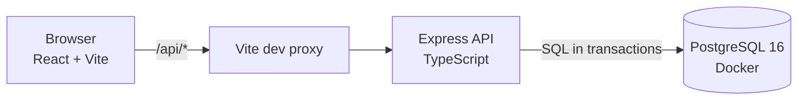

# Ops Desk — Newtonite "Operations Under Pressure"

An internal web app for creating, assigning, tracking and resolving operational work items (incidents, customer issues, payments, compliance, tasks) across teams.

Users belong to one or more teams with a role per team. Work items move through a server-enforced workflow with a Lead approval step. Every important change is recorded in an append-only activity history. The focus is correct behaviour under pressure: concurrent claims, stale edits, retried requests and per-team authorization.

## Architecture



- **web/** – React UI. Talks only to `/api`, which Vite forwards to the API (no CORS needed).
- **server/** – Express + TypeScript API using plain SQL (`pg`). All permission checks and workflow rules live here.
- **PostgreSQL** – runs in Docker. Constraints, row-level conditional updates and indexes do the heavy lifting.

## Prerequisites

- Node.js 20+
- Docker Desktop (running)
- Free ports: 3000 (API), 5173 (UI), 5433 (Postgres)

## Run it

```bash
# 1. Start Postgres (mapped to port 5433 to avoid clashing with a local Postgres)
docker compose up -d

# 2. Create tables and load demo data
cd server
cp .env.example .env
npm install
docker compose exec -T db psql -U ops -d ops < db/schema.sql
docker compose exec -T db psql -U ops -d ops < db/seed.sql

# 3. Start the API (leave this terminal running)
npm run dev                # http://localhost:3000

# 4. In a second terminal, from the repo root, start the UI
cd web
npm install
npm run dev                # open http://localhost:5173
```

To reset the database: `docker compose down -v`, then repeat steps 1–2.

## Demo logins

All passwords are `password123`. The login page has one-click buttons for these.

| Email | Team(s) and role |
|---|---|
| admin@ops.test | Admin in all teams |
| pay.lead@ops.test | Payments – Lead |
| pay.member@ops.test | Payments – Member, Support – Viewer |
| pay.viewer@ops.test | Payments – Viewer |
| sup.lead@ops.test | Support – Lead |
| sup.member@ops.test | Support – Member |
| sup.viewer@ops.test | Support – Viewer |
| comp.lead@ops.test | Compliance – Lead |
| comp.member@ops.test | Compliance – Member |
| comp.viewer@ops.test | Compliance – Viewer |

The seed also creates 3,000 work items so pagination and filtering work on realistic volume.

**Try the conflict handling:** log in as Payments Lead in one window and Payments Member in a private window. Open the same item in both and click Edit in both. Save in one, then save in the other: the second gets a "someone else changed this item" message and the latest version, instead of silently overwriting.

## Run the tests

With Postgres running and the seed loaded:

```bash
cd server
npm test
```

The API tests cover:

- two parallel claims → exactly one succeeds (200) and one gets 409
- an update with an old `version` → 409, data unchanged
- the same `Idempotency-Key` sent twice in parallel → one item created
- invalid workflow jump (Open → Closed) → rejected
- a Member cannot approve; a Lead can
- a user from another team gets 404 on read and write
- a Viewer can read but not claim
- requests without a token get 401

## API overview

| Method & path | What it does |
|---|---|
| `POST /auth/login` | Email + password → JWT |
| `GET /me`, `GET /teams`, `GET /users` | Current user, my teams with my role, people in my teams |
| `GET /items?view=&status=&priority=&team=&assignee=&q=&cursor=&limit=` | Server-side filtered, cursor-paginated list. Views: `mine`, `unassigned_urgent`, `awaiting_approval` |
| `POST /items` | Create (supports `Idempotency-Key` header) |
| `GET /items/:id` | Detail |
| `PATCH /items/:id` | Edit title/description/priority/due date; requires current `version` |
| `POST /items/:id/claim` | Atomic claim; 409 if someone already has it |
| `POST /items/:id/transition` | `{ to, version }`; workflow + approval rules enforced |
| `GET /items/:id/activity` | History of the item |
| `POST /items/:id/comments` | Add a comment |

## Known limitations

- **No background jobs yet.** There is no outbox/worker, so "notify the new assignee" is not implemented.
- **No reassignment endpoint.** Items can be claimed, but a Lead cannot yet assign them to someone else.
- **Tests use the development database.** Each test creates its own items so they are independent, but a separate test database would be cleaner.
- **Search uses `ILIKE`.** That is fine at this size but would need a full-text index (or a search engine) at large scale.
- **Only Postgres runs in Docker.** The API and UI are started with `npm run dev`; they are not containerised yet.
- **Simple auth.** JWT stored in the browser's localStorage, no refresh tokens, no rate limiting on login.
- **No real-time updates.** The UI polls every 10–15 seconds instead of using websockets.

See [ENGINEERING_DECISIONS.md](ENGINEERING_DECISIONS.md) for the reasoning behind the main design choices.
